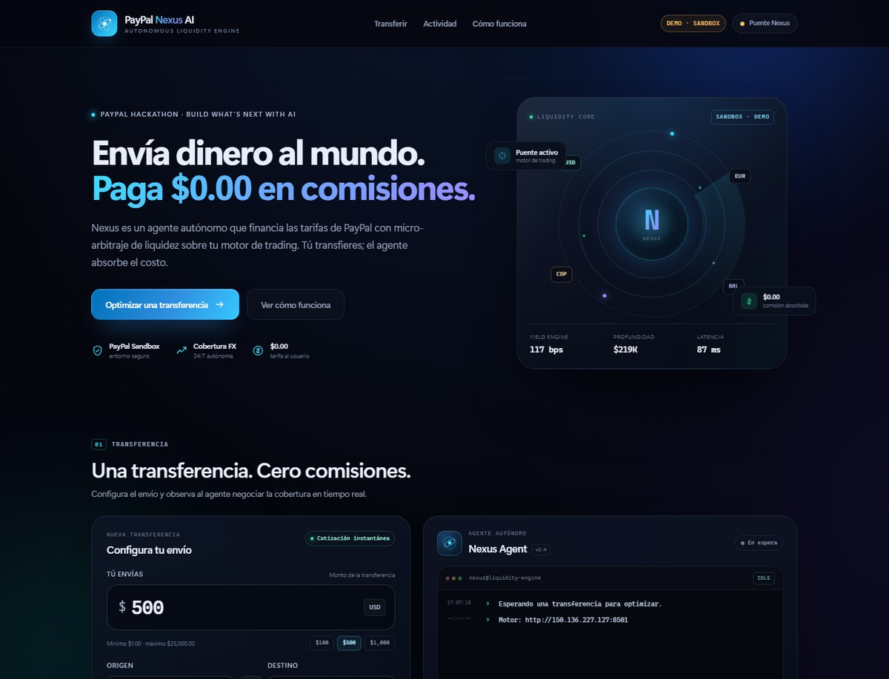
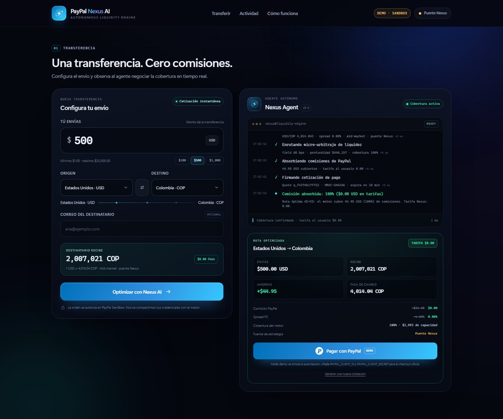
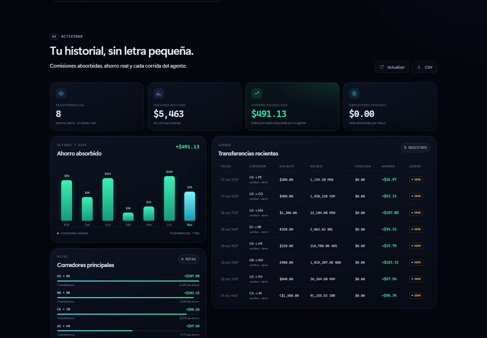
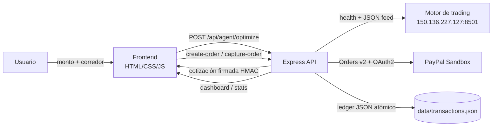

# PayPal Nexus AI

**Transferencias internacionales con $0.00 en comisiones para el usuario, financiadas por un agente autónomo de liquidez.**

Proyecto construido para el hackathon **Build What’s Next with PayPal and AI**. Nexus conecta PayPal Orders v2 (Sandbox) con tu motor de trading en `http://150.136.227.127:8501` y presenta una interfaz que hace visible —y auditable— el trabajo del agente: handshake, cobertura FX, micro-arbitraje y captura del pago.

> **Estado del motor remoto:** `150.136.227.127:8501` responde `HTTP 200` y `/_stcore/health → ok`, pero es una app **Streamlit** que devuelve el mismo shell HTML en todas las rutas y no expone un feed JSON público. Nexus está preparado para consumir un feed JSON si lo publicas; mientras tanto usa un **puente determinista** y lo etiqueta como tal en cada cotización. No se presenta telemetría simulada como si fuera real.



---

## Lo que puedes probar en 60 segundos

```bash
npm install
cp .env.example .env      # opcional: sin credenciales arranca en modo demo
npm start
# → http://localhost:3000
```

Demo sin credenciales:

1. Monto `500 USD`, origen **Estados Unidos**, destino **Colombia**.
2. **Optimizar con Nexus AI** → terminal del agente, ruta, tasa y **tarifa $0.00**.
3. **Pagar con PayPal** → checkout demo (o el botón oficial si configuraste Sandbox).
4. Recibo, ledger y ahorro acumulado en el dashboard.

Para conectar un feed JSON local de prueba:

```bash
npm run mock-bot                          # motor Streamlit-like en :8501
# en otra terminal:
BOT_URL=http://localhost:8501 npm start
```

### La cotización



### El dashboard



---

## Arquitectura



**Flujo de una transferencia**

1. El frontend envía monto y corredor. El servidor valida y deriva las monedas de los países (nunca confía en una tasa del cliente).
2. El adaptador consulta el motor: primero busca un feed JSON, luego `/_stcore/health`; si no hay feed, usa el puente determinista.
3. El motor de cotización calcula tasa mid-market, payout, benchmark de comisiones tradicionales, comisión Nexus `$0.00` y cobertura de liquidez.
4. Se firma una cotización HMAC-SHA256 con expiración de 10 minutos (self-contained, válida en serverless).
5. `create-order` crea la orden en PayPal Orders v2 con el monto de la cotización firmada.
6. `capture-order` captura el pago, registra la transacción en el ledger y devuelve el recibo.
7. El dashboard agrega ahorro, volumen, series de 7 días y corredores.

---

## Stack

| Capa | Elección | Por qué |
|---|---|---|
| Backend | Node.js 22 · Express 4 | Cero fricción de despliegue, `fetch` nativo, superficie mínima |
| PayPal | Orders v2 REST + OAuth2 | SDK oficial vía JS SDK en el navegador; secretos sólo en servidor |
| Frontend | HTML + CSS + JavaScript ES2020 | Sin build, sin CDN, carga instantánea; diseño a medida |
| Persistencia | JSON con escritura atómica | Suficiente para una demo; reemplazable por Postgres/Redis |
| Tests | `node:test` | 8 pruebas de integración y unidad, sin dependencias extra |
| Deploy | Render · Vercel · Docker | Un servicio para el full-stack; adapter serverless incluido |

No usa React/Tailwind: la opción **HTML/JS dinámico** del brief se implementó con un design system propio para evitar un paso de build y una cadena de dependencias en el hackathon. La UI es responsive, accesible y sin fuentes externas.

---

## Modos de ejecución

| Modo | Cuándo | Checkout |
|---|---|---|
| `demo` | Sin `PAYPAL_CLIENT_ID` / `PAYPAL_CLIENT_SECRET` | Modal de simulación; **no mueve dinero**. Todo el flujo se prueba igual. |
| `sandbox` | Credenciales Sandbox presentes | Botón oficial de PayPal (JS SDK) + Orders v2 real en Sandbox. |
| `live` | `PAYPAL_ENV=live` + credenciales live | **No recomendado para el hackathon.** |

El badge superior siempre indica el modo. El ledger marca cada registro con `demo` cuando corresponde.

---

## Configurar PayPal Sandbox

1. Entra a [developer.paypal.com](https://developer.paypal.com/dashboard/applications/sandbox) → **Apps & Credentials** → **Sandbox** → **Create App**.
2. Copia **Client ID** y **Secret**.
3. Crea o usa una cuenta **Sandbox Personal** para pagar (Sandbox → Accounts).
4. Completa `.env`:

```env
PAYPAL_CLIENT_ID=AX...
PAYPAL_CLIENT_SECRET=EL...
PAYPAL_ENV=sandbox
PUBLIC_BASE_URL=http://localhost:3000
QUOTE_SECRET=una-cadena-larga-y-aleatoria
```

5. Reinicia `npm start`. El badge cambia a **PAYPAL SANDBOX** y el botón oficial se renderiza dentro de la cotización.

**Webhook opcional:** crea un webhook en la app Sandbox apuntando a `https://tu-dominio/api/paypal/webhook`, suscríbelo a `PAYMENT.CAPTURE.COMPLETED` y copia el ID a `PAYPAL_WEBHOOK_ID`. El endpoint verifica la firma contra PayPal antes de aceptar el evento. En local necesitas un túnel (ngrok/Cloudflare Tunnel).

> Sandbox no mueve dinero real. Para producción se requieren credenciales live, revisión de la cuenta, webhooks y cumplimiento KYC/AML.

---

## Variables de entorno

| Variable | Default | Descripción |
|---|---|---|
| `PORT` | `3000` | Puerto HTTP |
| `PUBLIC_BASE_URL` | `http://localhost:3000` | URL pública para `return_url` / `cancel_url` de PayPal |
| `NODE_ENV` | `development` | En `production` activa HSTS y `upgrade-insecure-requests` |
| `PAYPAL_CLIENT_ID` | — | Client ID Sandbox/live |
| `PAYPAL_CLIENT_SECRET` | — | Secret (sólo servidor) |
| `PAYPAL_ENV` | `sandbox` | `sandbox` o `live` |
| `PAYPAL_WEBHOOK_ID` | — | Habilita verificación de webhooks |
| `BOT_URL` | `http://150.136.227.127:8501` | Motor de trading |
| `BOT_STRATEGY_PATH` | `/nexus/strategy,/api/strategy,/strategy,/.well-known/nexus.json` | Rutas JSON a probar |
| `BOT_API_KEY` | — | Se envía como `X-API-Key` |
| `BOT_TIMEOUT_MS` | `3500` | Timeout por sonda |
| `BOT_CACHE_MS` | `15000` | Caché de telemetría |
| `NEXUS_OFFLINE` | `0` | `1` fuerza simulación (CI) |
| `CROSS_BORDER_FEE_PCT` | `4.99` | Benchmark de comisión PayPal |
| `FX_SPREAD_PCT` | `4.00` | Benchmark de spread FX |
| `MIN_TRANSFER_AMOUNT` | `1` | Límite mínimo |
| `MAX_TRANSFER_AMOUNT` | `25000` | Límite máximo |
| `QUOTE_SECRET` | aleatorio al arrancar | Firma HMAC de cotizaciones; **fija uno en producción** |
| `DATA_DIR` | `./data` | Directorio del ledger |
| `SEED_DEMO` | `1` si no hay PayPal | Siembra 8 registros demo al primer arranque |
| `ALLOWED_ORIGINS` | — | Orígenes CORS separados por coma (opcional) |

---

## API

### `POST /api/agent/optimize`

```bash
curl -s http://localhost:3000/api/agent/optimize \
  -H 'Content-Type: application/json' \
  -d '{"amount":500,"sourceCountry":"US","destinationCountry":"CO","recipientEmail":"ana@ejemplo.com"}'
```

Respuesta (resumida):

```json
{
  "ok": true,
  "quote": {
    "id": "q_4e30fecf7e83",
    "token": "eyJ2IjoxLCJpZCI6...<HMAC>",
    "amount": 500,
    "sourceCurrency": "USD",
    "recipientAmount": 2008861,
    "recipientCurrency": "COP",
    "exchangeRate": 4017.72,
    "fees": {
      "charged": { "amount": 0, "currency": "USD", "pct": 0 },
      "benchmark": { "paypalFee": 24.95, "fxFee": 20, "total": 44.95, "totalPct": 8.99 },
      "absorbed": { "amount": 44.95, "currency": "USD", "usd": 44.95, "pct": 100 }
    },
    "savings": { "amount": 44.95, "currency": "USD", "usd": 44.95, "pct": 8.99 },
    "strategy": {
      "source": "bridge",
      "rateSource": "nexus-bridge",
      "yieldBps": 68,
      "liquidityUsd": 374087,
      "coveragePct": 100
    },
    "steps": [
      { "id": "connect", "label": "Conectando con el motor de trading", "status": "ok", "durationMs": 85 },
      { "id": "hedge", "label": "Calculando cobertura de tasa cambiaria", "status": "ok" },
      { "id": "liquidity", "label": "Enrutando micro-arbitraje de liquidez", "status": "ok" },
      { "id": "absorb", "label": "Absorbiendo comisiones de PayPal", "status": "ok" },
      { "id": "sign", "label": "Firmando cotización de pago", "status": "ok" }
    ]
  }
}
```

El `quote.token` es obligatorio para crear y capturar la orden. Caduca en 10 minutos.

### `POST /api/paypal/create-order`

```bash
curl -s http://localhost:3000/api/paypal/create-order \
  -H 'Content-Type: application/json' \
  -d '{"quoteId":"q_4e30fecf7e83","quoteToken":"<token>"}'
```

Devuelve `order.id` y, en Sandbox, `approvalUrl`. El monto se toma **del token firmado**, no del body.

### `POST /api/paypal/capture-order`

```bash
curl -s http://localhost:3000/api/paypal/capture-order \
  -H 'Content-Type: application/json' \
  -d '{"orderId":"DEMO-...","quoteToken":"<token>"}'
```

Idempotente por `orderId`: un reintento devuelve la transacción original sin duplicar el ledger.

### Otros endpoints

| Método | Ruta | Descripción |
|---|---|---|
| `GET` | `/api/health` | Liveness para Render/Docker |
| `GET` | `/api/config` | Países, monedas, modo y límites (client ID público; nunca el secret) |
| `GET` | `/api/agent/status` | Estado del motor + telemetría cacheada |
| `GET` | `/api/dashboard?limit=12` | Totales, serie de 7 días, corredores y transacciones |
| `GET` | `/api/dashboard/transactions` | Listado del ledger |
| `GET` | `/api/dashboard/export.csv` | Exportación CSV |
| `POST` | `/api/paypal/webhook` | Verificación de firma PayPal |

---

## Modelo de comisiones

Para un envío de `A` en la moneda origen:

```
comisión PayPal tradicional = A × 4.99%
spread FX tradicional        = A × 4.00%
costo tradicional            = A × 8.99%

comisión Nexus cobrada       = 0
ahorro del usuario           = A × 8.99%
```

El agente calcula la capacidad de cobertura como `liquidez × yieldBps / 10000` y la compara con el costo absorbido. Si la cobertura fuera menor al 100%, la UI lo marca en ámbar y Nexus cubre el resto con su reserva (la tarifa al usuario sigue en `$0.00`). El benchmark es una **referencia**, no una factura real de PayPal; la app lo declara en el footer y en cada cotización.

Ejemplo con `500 USD → COP`:

| Concepto | Tradicional | Nexus |
|---|---:|---:|
| Comisión PayPal | $24.95 | **$0.00** |
| Spread FX | $20.00 | **$0.00** |
| Total | **$44.95** | **$0.00** |
| Destinatario recibe | menos comisiones | `~2,008,861 COP` (tasa mid-market) |

---

## Integración con el motor de trading

El adaptador es tolerante a formatos y nunca tumba la app si el bot falla:

1. Prueba rutas JSON configurables (`BOT_STRATEGY_PATH`).
2. Si no hay JSON, consulta `/_stcore/health`, `/healthz`, `/api/health`.
3. Si el motor está en línea pero sin feed, usa el **puente determinista** (`source: bridge`).
4. Si no responde, activa simulación (`source: simulated`) en milisegundos.

Contrato recomendado y sidecar FastAPI listo para copiar: **[docs/BOT_INTEGRATION.md](docs/BOT_INTEGRATION.md)**.

---

## Tests

```bash
npm test        # 8 tests: matemática, HMAC, API, checkout demo, idempotencia, headers
npm run smoke   # boot + optimize + create + capture en un puerto aleatorio
```

Resultado esperado: `8 pass`, `Smoke test OK`, sin llamadas a PayPal ni al bot remoto (usa `NEXUS_OFFLINE=1`).

---

## Despliegue

### Render (recomendado: full-stack, un solo servicio)

[](https://render.com/deploy)

1. Sube el repo a GitHub.
2. En Render: **New → Blueprint** y selecciona el repo. Se usa [`render.yaml`](render.yaml).
3. Define en el dashboard:
   - `PAYPAL_CLIENT_ID`, `PAYPAL_CLIENT_SECRET` (opcional; sin ellas sigue en demo)
   - `PUBLIC_BASE_URL` = `https://tu-servicio.onrender.com`
   - `QUOTE_SECRET` (Render lo genera si usas el blueprint)
4. Deploy. Health check: `/api/health`.
5. En el plan free el disco es efímero: el ledger se reinicia en cada deploy. Para persistencia, sube a un plan con disco, monta `/var/data` y define `DATA_DIR=/var/data`.

### Vercel (serverless, adapter incluido)

```bash
npm i -g vercel
vercel --prod
```

Configura en **Project → Settings → Environment Variables**:

```env
PAYPAL_CLIENT_ID=...
PAYPAL_CLIENT_SECRET=...
QUOTE_SECRET=...
PUBLIC_BASE_URL=https://tu-proyecto.vercel.app
BOT_URL=http://150.136.227.127:8501
DATA_DIR=/tmp/nexus
SEED_DEMO=1
```

[`vercel.json`](vercel.json) reescribe cada endpoint a [`api/index.js`](api/index.js), que reutiliza el mismo Express. En Vercel el filesystem es efímero y cada instancia tiene su `/tmp`: el ledger **no es durable**. Para producción usa Vercel KV/Postgres y adapta `Ledger`.

### Docker / Railway / Fly.io

```bash
docker build -t paypal-nexus-ai .
docker run --rm -p 3000:3000 --env-file .env paypal-nexus-ai
```

La imagen corre como usuario no root, con health check en `/api/health`. En Railway: **New Project → Deploy from Dockerfile** y añade las variables.

---

## Seguridad

- Secretos sólo en el servidor; el navegador recibe únicamente el `client-id` público.
- Cotizaciones firmadas con HMAC-SHA256, expiración de 10 min y comparación en tiempo constante.
- El monto de PayPal se toma del token firmado, no del body del cliente.
- Validación estricta de montos, países, monedas y emails; límites por transferencia.
- Rate limiting en memoria por IP (240 req/min global, 30 en checkout/agente).
- Cabeceras CSP, `nosniff`, `frame-ancestors 'none'`, `Referrer-Policy`, `Permissions-Policy`; HSTS en producción.
- Captura idempotente para evitar dobles registros.
- Webhooks verificados contra PayPal cuando `PAYPAL_WEBHOOK_ID` está configurado.
- Ledger con escritura atómica y fallback a memoria si el FS es de sólo lectura.
- No se almacenan datos de tarjeta; sólo IDs de orden/captura y correos enmascarados.

**Para producción real:** base de datos, Redis para rate limiting e idempotencia distribuida, gestión de secretos (KMS/Vault), observabilidad, KYC/AML, revisión legal y credenciales live.

---

## Estructura

```
.
├── server/
│   ├── index.js              # bootstrap + graceful shutdown
│   ├── app.js                # Express, seguridad, estáticos, errores
│   ├── config.js             # env + modo demo/sandbox
│   ├── lib/                  # http, money, validate, HMAC, rate limit, mercado
│   ├── routes/               # system, agent, paypal, dashboard
│   └── services/
│       ├── agent.js          # motor de cotización y cobertura
│       ├── bot.js            # adaptador bot/bridge/simulated
│       ├── paypal.js         # OAuth2 + Orders v2 + webhooks
│       └── ledger.js         # persistencia y estadísticas
├── public/                   # UI sin build (index, styles, app, assets)
├── mock-bot/server.js        # Streamlit-like + feed JSON local
├── tests/                    # node:test (unidad + integración)
├── scripts/smoke.js          # smoke test autocontenido
├── api/index.js              # adapter Vercel
├── render.yaml · vercel.json · Dockerfile
└── docs/BOT_INTEGRATION.md
```

---

## Guion de demo para jueces (90 s)

1. **Problema:** una transferencia internacional de $500 puede perder ~$45 entre comisión y spread.
2. **Agente:** muestra el badge del motor (`Motor vinculado`/`Puente Nexus`) y explica la transparencia del feed.
3. **Optimización:** envía 500 USD → COP. La terminal recorre handshake, cobertura FX, liquidez, absorción y firma HMAC.
4. **Resultado:** tarifa $0.00, ahorro $44.95, cobertura 100% y tasa mid-market.
5. **PayPal:** autoriza en Sandbox (o modal demo), muestra el recibo y los IDs.
6. **Dashboard:** +1 transferencia, ahorro acumulado, serie de 7 días y CSV.
7. **Cierre:** “El usuario no paga comisiones; el agente las cubre con liquidez. Todo el flujo está instrumentado y es auditable.”

---

## Limitaciones conocidas

- El bot remoto es Streamlit y **no expone feed JSON**; el puente determinista es explícito y no debe interpretarse como mercado en vivo.
- El benchmark de 8.99% es una referencia de la industria, no una cotización facturada por PayPal.
- El ledger JSON y el rate limit en memoria son de una sola instancia; no aptos para alta concurrencia.
- Vercel `/tmp` y Render free no persisten el ledger entre despliegues.
- No hay KYC/AML ni cumplimiento regulatorio: es un prototipo de hackathon.

---

## Próximos pasos

- Publicar el feed JSON real del bot (sidecar en `docs/BOT_INTEGRATION.md`) y usar tasas en vivo.
- Ledger Postgres + idempotencia distribuida.
- Motor de cobertura con órdenes reales y contabilidad por transferencia.
- Webhooks como fuente de verdad del estado de captura.
- Multi-tenant, roles, auditoría y límites por usuario.
- Tests E2E con Playwright contra Sandbox.

---

Hecho con foco en **transparencia**: cada comisión, tasa y fuente de datos se muestra en la UI. Si el motor no puede demostrar que está en vivo, Nexus lo dice.
